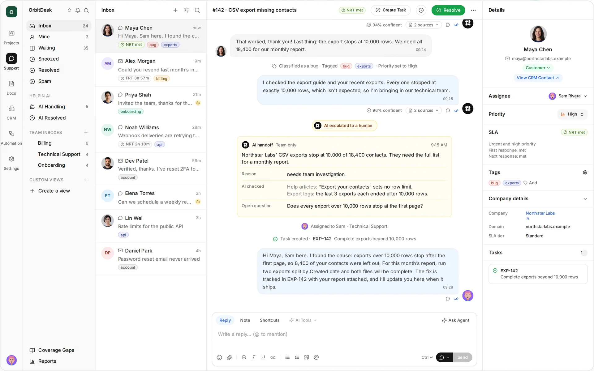
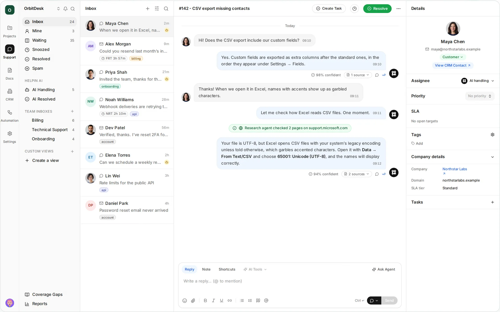
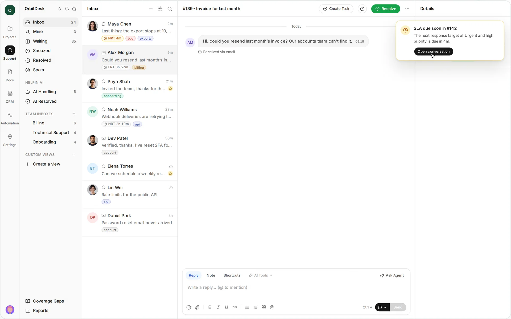
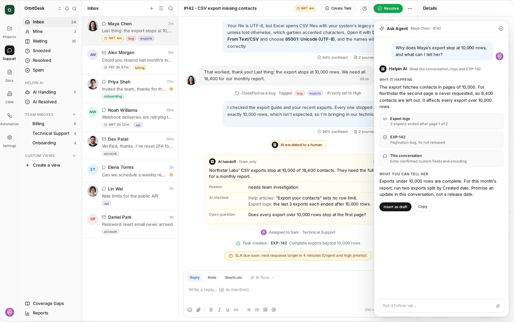
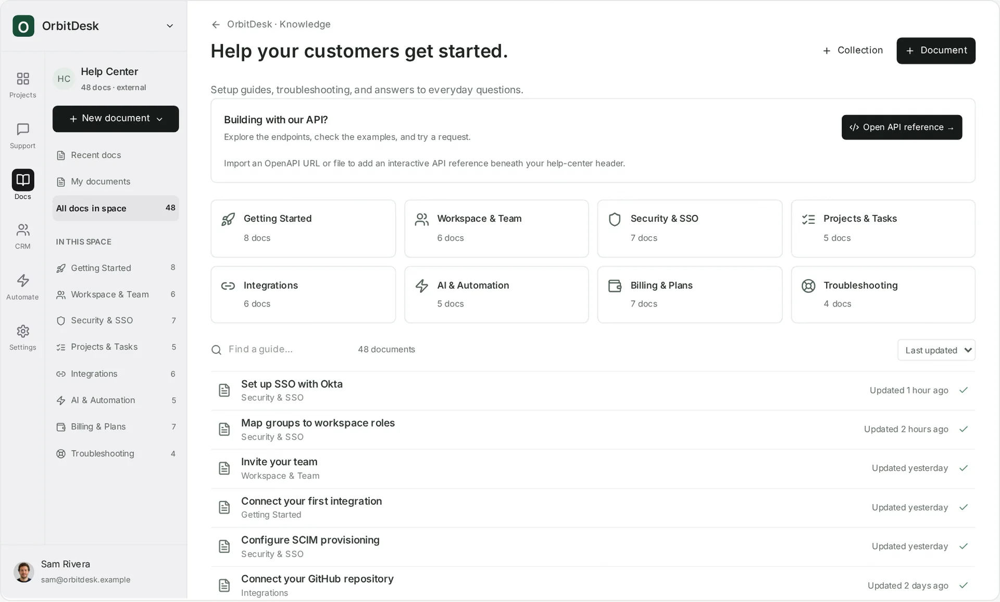
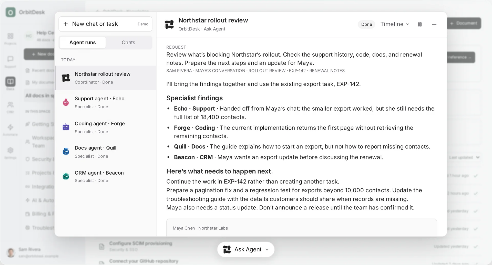

# Helpin

**Open-source customer support, with AI agents that do more than answer.**

Helpin gives a software team support chat, a shared inbox, a help center, and
AI agents that answer from your docs and hand over to your team. Self-host it
with your own AI providers, where your data has to live, or use Helpin Cloud.

When a conversation turns out to be a bug or an account question, the task and
the customer record are already next to the reply: Projects and CRM are built
in, so nothing is lost at the handoff.

Coming from Intercom? See [how Helpin compares](https://helpin.ai/compare/intercom).

[Website](https://helpin.ai) · [Open Helpin Cloud](https://app.helpin.ai) ·
[Get started](#get-started) · [Contribute](CONTRIBUTING.md)



*Product preview with fictional data. The AI answered two questions, escalated
the third with what it had checked, and a teammate replied inside the response
target. Available modules depend on your deployment.*

## Get started

### Use Helpin Cloud

[Open a managed workspace](https://app.helpin.ai) and explore the product without
operating the infrastructure. See [Cloud plans](https://helpin.ai/pricing) for
capacity, agent capabilities, and AI usage.

### Run Helpin yourself

**Community 0.2 beta** includes support chat, the shared inbox, and the help
center, together with Docs, Projects, CRM, automation, and AI agents, including
coding agents. Read the
[release scope and known limitations](ROADMAP.md) before choosing a deployment.

You need Linux or macOS on amd64 or arm64, Docker Engine or Docker Desktop,
Compose v2, Bash, OpenSSL, curl, and `sha256sum` or `shasum`.
Start with **8 GiB RAM and 20 GiB free disk** for evaluation; source builds need
more. These are starting points, not production capacity limits.

**Install with the CLI.** Once a Community release with CLI assets is
published, run the installer from the website:

```sh
curl -fsSL https://helpin.ai/install.sh | bash
"$HOME/.local/bin/helpin" install
```

Choose local or public server setup. The CLI downloads and verifies the bundle,
guides configuration, and starts Helpin. For local setup, open
**http://localhost:8085**, sign up, and create an organization and workspace.

- [CLI options](docs/community/cli.md): versions, install directory, server setup, and unattended installation.
- [Manual bundle installation](community/README.md#manual-bundle-installation): download a release and use `setup.sh`.
- [Build from source](docs/community/development.md#source-builds-and-acceptance): requires access to the separate Agent Runtime repository at the pinned revision.

### Send your first message

1. In workspace settings, allow your website’s origin, including its scheme and
   port. The widget refuses visitor requests while the origin list is empty.
2. Copy the generated support installation snippet into that website.
3. Send a visitor message, then reply from the staff inbox. Seeing that reply in
   the widget confirms the conversation works in both directions.
4. Optionally publish a help-center article or configure a shared connection and
   workspace default under **Settings → AI**.

AI is optional for human chat and published articles. Your team operates a
self-hosted installation; connected AI, email, and meeting services may still
process data outside it and charge for usage. Before public hosting, configure
[DNS and HTTPS](docs/community/deployment.md) and
[backups](docs/community/backups.md).

## Why Helpin?

A customer asks a question. The AI answers what it can from your docs and asks
for a moment when it needs to look something up. When the question needs a
person, it hands over with what it checked and what is still open.

Your teammate replies without asking the customer to repeat themselves. If the
question turns out to be a bug, the task, the fix, and the follow-up stay
attached to the conversation.

**The earlier conversation should change the next action—not disappear at the handoff.**

## What you can do

Support is the product. The rest is there for when a conversation needs it.

- **One inbox for every channel.** Chat, email, and Telegram conversations in
  one shared inbox, sorted into team inboxes, with tags and customer history.
  Support email needs a configured email provider.
- **SLAs your team can see.** First- and next-response targets per policy, a
  timer on every conversation, and a warning before a target is missed.
- **A customer portal.** Customers sign in to follow their requests, search
  their history, and read customer-only help.
- **AI agents that follow up.** Agents answer from your docs, start a research
  agent when they need more, classify and tag the conversation, and hand over
  to a teammate with their findings.
- **Ask Agent before you reply.** Ask why something happened and get the cause,
  with evidence from the conversation, the linked task, and connected tools.
- **A help center that stays current.** From support, coverage gaps group
  unanswered questions and failed searches, and an agent drafts the missing
  guide. After a release, an agent finds guides that fell behind and prepares
  updated steps and screenshots. Nothing is published without your team.

<table>
  <tr>
    <td width="50%" valign="top">
      <a href="docs/images/helpin-support-ai-research.webp"></a>
      <br><sub><b>AI answers</b> · A research agent looks it up while the customer waits.</sub>
    </td>
    <td width="50%" valign="top">
      <a href="docs/images/helpin-support-sla-warning.webp"></a>
      <br><sub><b>SLAs</b> · A warning before a response target is missed.</sub>
    </td>
  </tr>
  <tr>
    <td width="50%" valign="top">
      <a href="docs/images/helpin-support-ask-agent.webp"></a>
      <br><sub><b>Ask Agent</b> · The cause and what to tell the customer, before you reply.</sub>
    </td>
    <td width="50%" valign="top">
      <a href="docs/images/helpin-knowledge-help-center.webp"></a>
      <br><sub><b>Knowledge</b> · Help-center guides, internal docs, and an API reference.</sub>
    </td>
  </tr>
</table>

*Product previews with fictional data.*

**Built in, for when support needs it:** Projects turns the bug behind a
conversation into a task, CRM keeps contacts, companies, and deals next to
their conversations, and Meetings records decisions and next steps.

Community 0.2 enables Support, Docs, Projects, CRM, automation, and agents by
default; set `HELPIN_ENABLED_MODULES=support,docs,agents` for support only.
Cloud plans and configured integrations determine which additional
capabilities you can use.

## See the difference in one request

*An illustrative workflow; available actions depend on your configuration.*

A customer writes:

> “The smaller export worked, but I still need the full contact list.”

The history matters. Recommending the same workaround again will not resolve
the request.

The team and agents can review the earlier attempt, attach findings to the
existing export task, and prepare the next step without creating duplicate work.
Once the team has reviewed the change and confirmed its release, the customer
update can explain what changed and what to try next.

```text
Customer question
  → Earlier conversation and existing task
  → Investigation and proposed work
  → Team review and release confirmation
  → Customer follow-up
```

A task marked complete is not the same as a confirmed release. A drafted reply
is not a sent message.

## Ask Agent and the specialists

Ask Agent is where your team starts: ask about an account, investigate a request,
or prepare a plan. Specialist agents handle focused work when needed.



> “What is blocking this customer’s rollout, and what have we already tried?”

> “Review the linked task and propose the next steps.”

> “Prepare an update using the latest confirmed release status.”

Choose the tools an agent can use and the actions that require review. Your team
still decides priorities, scope, and customer commitments. See
[agents and automation](docs/agents-and-automation.md) for how the pieces connect.

## Helpin and Agent Runtime

Helpin is the product your team works in: customer records, conversations,
projects, and the interface for doing the work.

[Agent Runtime](https://github.com/helpin-ai/agent-runtime) is the separate
execution project for developers adding agent runs to their own applications.
Helpin owns its customer history and product workflows; the runtime executes
agents through configured interfaces. Repository access is required to build
the runtime from source.

## Build with Helpin

Embed support in your application, connect customer data, and extend your team’s
workflows. Start with the [JavaScript SDK](packages/sdk-js/README.md),
[React integration](packages/react/README.md), or
[MCP integration](integrations/helpin-mcp/README.md).

Keep identity verification, account authorization, and agent tool permissions
separate. Identifying a customer does not grant access to every record or
connected system.

For development and operations, use the [documentation index](docs/README.md),
[architecture overview](ARCHITECTURE.md), and
[local development guide](docs/development.md). See [support](SUPPORT.md) for
questions and reproducible bug reports.

## Contributing

Start with a reproducible bug report, a documentation correction, or a small
improvement to an everyday workflow. For larger changes, open an issue describing
the problem and proposed approach before implementation.

Read the [contributor guide](CONTRIBUTING.md) for setup, checks, and the
contribution agreement that applies to your changes. Follow the
[code of conduct](CODE_OF_CONDUCT.md).

## Security

Do not post credentials, private customer data, or sensitive vulnerability
details in public issues. Use the private reporting channel in the
[security policy](SECURITY.md).

## License

The Community application is **AGPL-3.0-only**. The public SDK and widget
packages listed in [LICENSE](LICENSE) are **Apache-2.0**. Code in `ee/`
directories uses the [Helpin Enterprise License](ee/LICENSE); production use
requires a commercial agreement.

[Read the license](LICENSE) for exact scopes, third-party exceptions, and
trademark terms.

---

**Open-source customer support, with AI agents that do more than answer.**
